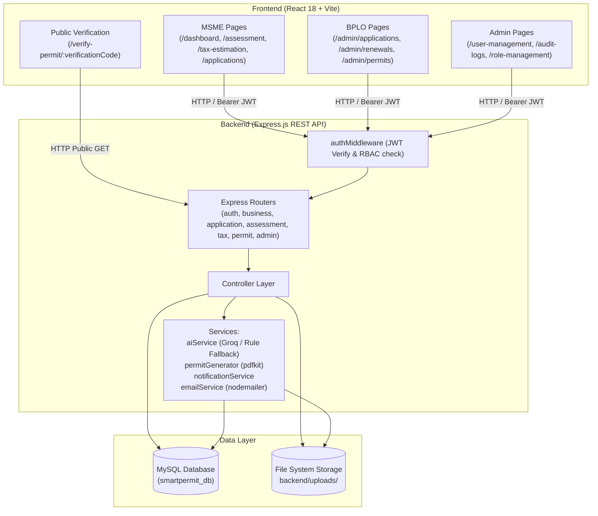
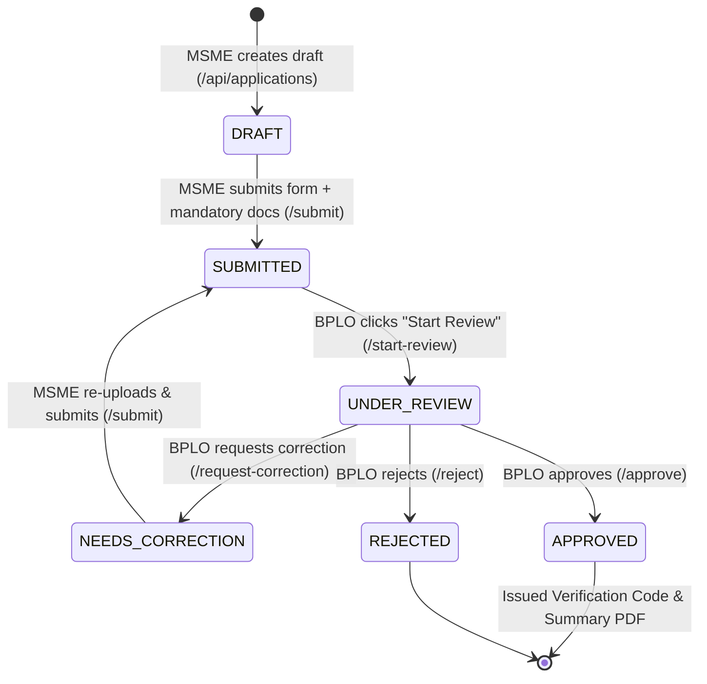

# PermitEase: Actual Implemented System Flow & Codebase Audit

**Audit Date:** October 27, 2026  
**Repository Branch / Commit:** `main` / `205dad1` ("feat(ui): make all admin and BPLO personnel pages fully responsive for mobile portrait")  
**Target System:** PermitEase — Guided Business Permit Preparation and Readiness Assessment System (Municipality of Roxas, Oriental Mindoro)  
**Investigation Methodology:** Direct source code analysis across frontend (`frontend/src`), backend (`backend/`), database migrations (`database/`), and runtime configuration (`.env`). No speculative, planned, or aspirational features are documented as functional unless verified in code.

---

## 1. Verified System Architecture

### 1.1 Technology Stack & Entry Points
- **Frontend Framework:** React 18 SPA built with Vite (`frontend/src/main.jsx`).
- **Frontend Router:** React Router v6 (`frontend/src/App.jsx`).
- **Styling:** Vanilla CSS with custom design tokens and media queries (`frontend/src/index.css`), Lucide React icons.
- **Backend Framework:** Express.js 4 REST API (`backend/server.js`).
- **Database:** MySQL 8.0 / MariaDB accessed via `mysql2/promise` connection pool (`backend/config/db.js`), local database `smartpermit_db`.
- **AI Integration:** Groq SDK (`groq-sdk`) calling model `qwen/qwen3.8-27b` (configurable via `GROQ_MODEL`) with a local deterministic rule-based fallback (`backend/services/aiService.js`).
- **File Handling:** `multer` storage disk engine saving to `backend/uploads/` with 10MB limit; `pdfkit` for PDF generation (`backend/services/permitGenerator.js`).
- **Email Notifications:** `nodemailer` with SMTP transport via Mailtrap (`backend/services/emailService.js`).
- **External Links:** Outbound new-tab link to official DICT iBPLS portal (`https://bpbc.ibpls.com/roxasorientalmindoro/`). No programmatic data transfer exists.

### 1.2 Architecture Diagram



---

## 2. Actual Implemented User Roles & Permissions

The database enforces three distinct user roles via an `ENUM` in the `users` table:
`role ENUM('business_owner', 'lgu_admin', 'system_admin') DEFAULT 'business_owner'` (`database/rbac_migration.sql`).

### 2.1 Role-Permission Matrix

| Action / Resource | Public | `business_owner` | `lgu_admin` | `system_admin` | Evidence (Backend Route & Controller) |
|---|:---:|:---:|:---:|:---:|---|
| **Register Account** | ✅ | ❌ | ❌ | ❌ | `POST /api/auth/register` (`authController.js`) |
| **Login / Authenticate** | ✅ | ✅ | ✅ | ✅ | `POST /api/auth/login` (`authController.js`) |
| **Onboard / Manage Own Business** | ❌ | ✅ | ❌ | ✅ | `POST /api/businesses`, `PUT /api/businesses/:id` (`businessController.js`) |
| **AI Assessment Diagnostic** | ❌ | ✅ (Own) | 👁️ View | 👁️ View | `POST /api/assessments` (`assessmentController.js`) |
| **Calculate Taxes / Fees** | ❌ | ✅ (Own) | 👁️ View | 👁️ View | `GET /api/taxes/estimate/:businessId` (`taxController.js`) |
| **Upload / Delete Clearances** | ❌ | ✅ (Own) | 👁️ View | ✅ | `POST /api/documents/upload`, `DELETE /api/documents/:id` (`documentController.js`) |
| **Submit Application (`DRAFT` ➔ `SUBMITTED`)** | ❌ | ✅ (Own) | ❌ | ❌ | `POST /api/applications/:id/submit` (`applicationController.js`) |
| **Start Review (`SUBMITTED` ➔ `UNDER_REVIEW`)** | ❌ | ❌ | ✅ | ✅ | `POST /api/admin/applications/:id/start-review` (`applicationController.js`) |
| **Request Correction (`UNDER_REVIEW` ➔ `NEEDS_CORRECTION`)** | ❌ | ❌ | ✅ | ✅ | `POST /api/admin/applications/:id/request-correction` (`applicationController.js`) |
| **Approve / Verify (`UNDER_REVIEW` ➔ `APPROVED`)** | ❌ | ❌ | ✅ | ✅ | `POST /api/admin/applications/:id/approve` (`applicationController.js`) |
| **Download Preparation Summary PDF** | ❌ | ✅ (Own) | ✅ | ✅ | `GET /api/applications/:id/preparation-summary` (`applicationController.js`) |
| **Download Verified Permit PDF** | ❌ | ✅ (Own) | ✅ | ✅ | `GET /api/permits/:id/download` (`permitController.js`) |
| **Verify Permit Publicly via Code** | ✅ | ✅ | ✅ | ✅ | `GET /api/permits/verify/:verificationCode` (`permitController.js`) |
| **Manage Tax / Fee Rules** | ❌ | ❌ | 👁️ View | ✅ Full CRUD | `taxRoutes.js`, `taxController.js` |
| **User Account Management** | ❌ | ❌ | ❌ | ✅ | `adminRoutes.js`, `adminController.js` |
| **Audit Log Forensics** | ❌ | ❌ | ❌ | ✅ | `GET /api/admin/audit-logs` (`adminController.js`) |
| **Role Matrix Display** | ❌ | ❌ | 👁️ View | 👁️ View | `RoleManagement.jsx` (Static UI only) |

---

## 3. Verified MSME / Business Owner Journey (`business_owner`)

### A. Registration & Authentication
- **Registration (`frontend/src/pages/Register.jsx`):**
  - Calls `POST /api/auth/register` (`authController.js:14`).
  - Inputs: `full_name`, `email`, `contact_number`, `password`.
  - Passwords hashed using `bcryptjs` with salt round 10 (`authController.js:33`).
  - Automatically assigned role `business_owner` and status `active`.
  - Issues JWT token containing `{ id, email, role, full_name }` with a 7-day expiration (`authController.js:47`).
- **Session Persistence:**
  - Token and user object stored in `localStorage` (`frontend/src/context/AuthContext.jsx:21`).
  - `axios` instance and standard `fetch` calls inject `Authorization: Bearer <token>`.
  - 401 response on any route triggers logout and redirects to `/login`.

### B. Onboarding & Business Profile Setup
- **Onboarding Guard:**
  - `BusinessContext.jsx` checks `GET /api/businesses/my` (`businessController.js:39`). If the user has 0 registered businesses, `isOnboarded` is set to `false`.
  - In `Sidebar.jsx:39`, un-onboarded users have their navigation restricted to Dashboard, Set Up My Business (`/onboarding`), Assistance tools, and Notifications.
- **Fields Captured (`frontend/src/pages/Onboarding.jsx` & `frontend/src/pages/BusinessProfile.jsx`):**
  - **Required:** `business_name`, `business_type`, `industry_category`, `address`, `capitalization` (new) or `gross_sales` (renewal), `business_status` (`New Application` or `Renewal`).
  - **Location Structure:** Island Group, Region, Province, Municipality (`PSGC 175212000` for Roxas), Barangay. Resolved against location database (`locationController.js`).
  - **Operational:** `ownership_type` (Sole Proprietorship, Partnership, Corporation, Cooperative), `premises_type` (Owned, Leased), `floor_area` ($m^2$), `employees`.
  - **Persistence:** Stored in `businesses` table.

### C. AI Business Assessment (`/assessment`)
- **Page Implementation:** `frontend/src/pages/Assessment.jsx`.
- **Backend Endpoint:** `POST /api/assessments` (`assessmentController.js:7`).
- **Execution Mechanism:**
  1. Frontend sends `business_id` or `business_description`.
  2. Backend pulls the complete business row from `businesses`.
  3. Queries `permit_requirements` table for all system rules.
  4. Calls `generateStructuredAssessment()` in `aiService.js:145`.
  5. Uses Groq SDK (`groq-sdk`) calling `qwen/qwen3.8-27b` with temperature 0.1 and strict JSON output schema.
  6. **Fallback Mechanism:** If `GROQ_API_KEY` is missing or the Groq API call fails, it automatically executes `generateRuleBasedAssessment()` (`aiService.js:21`), matching keywords (e.g., food, bakery, sari-sari, service) to determine industry category, business type, and standard municipal permits.
  7. Assessment result is stored in `assessments` table (`assessmentController.js:237`).
  8. Automatically evaluates applicable requirements and inserts missing rows into `business_requirements` table (`assessmentController.js:195`).

### D. Permit Readiness & Requirements Gathering (`/permits`, `/requirements`)
- **Requirements Determination:**
  - Deterministic condition evaluation in `complianceController.js:20` and `readinessController.js:23`.
  - Supported conditions: `always`, `industry_category`, `business_status`, `premises_type`, `business_type_contains`.
- **Checklist State:**
  - Persisted in `business_requirements` table with statuses: `Missing`, `Submitted`, `Approved`, `Rejected`, `Expired`.
  - BPLO verification status tracked in `bplo_status` (`AI Suggested`, `BPLO Verified`).
- **Readiness Score Calculation:**
  $$\text{Readiness Score} = \text{round}\left(\frac{\text{Submitted + Approved Reqs}}{\text{Total Applicable Reqs}} \times 100\right)$$
  Computed in `readinessController.js:189` and `dashboardController.js:110`.

### E. Document Uploads & Storage (`/documents`)
- **Accepted MIME Types:** `application/pdf`, `image/jpeg`, `image/png` (`documentController.js:21`).
- **File Size Limit:** 10 MB (`documentController.js:29`).
- **Storage Path:** Physical files stored in `backend/uploads/` with unique timestamped filenames (`Date.now() + '-' + originalname`).
- **Database Link:** Inserted into `documents` table (`id, business_id, document_name, file_path, expiration_date`).
- **Requirement Linkage:** If `requirement_id` is supplied in the upload payload, `documentController.js:95` updates `business_requirements.document_id` and sets status to `Submitted`.
- **Download Security:** `GET /api/documents/download/:id` verifies business ownership (`b.user_id === req.user.id`) or admin role before serving file via `res.sendFile()` (`documentController.js:154`).

### F. Tax and Fee Estimation (`/tax-estimation`, `/fee-estimation`)
- **Page Implementation:** `frontend/src/pages/TaxEstimation.jsx` and `FeeEstimation.jsx`.
- **Backend Endpoint:** `GET /api/taxes/estimate/:businessId` (`taxController.js:7`).
- **Calculation Architecture:** **100% deterministic code** inside `feeController.js:63` (`calculateFeesCore`). **No LLM or AI is used for financial arithmetic.**
- **LGU Validation:** Validates that `business.city_municipality_id === '175212000'` (Municipality of Roxas). If not, returns `supportedLGU: false`.
- **Formulas Implemented:**
  1. **Local Business Tax (LBT):**
     - Basis: `capitalization` (New Application) or `gross_sales` (Renewal).
     - **Statutory Retail Cap (RA 7160 Sec. 143(d)):** If `industry_category === 'Retail'` and `gross_sales > 400000`, the effective rate is strictly capped at **1.00%** (`effectiveRate = 0.01`) instead of 2.00% (`feeController.js:130`).
  2. **Regulatory Fees:**
     - Fixed rules: `fixed_amount` from `tax_fee_rules`.
     - Floor area rules: `rate * floor_area`.
  3. **BFP Fire Safety Inspection Fee (RA 9514 IRR Rule 12):**
     $$\text{FSIF} = \max(500.00, 0.15 \times \text{LGU Regulatory Fees Subtotal})$$
     Implemented in `feeController.js:155-165`.
  4. **Payment Schedule:** Generates verified quarterly installment breakdown (Q1: 25% tax + 100% fees; Q2: 25% tax; Q3: 25% tax; Q4: 25% tax balance) under RA 7160 Sections 165 & 167 (`taxController.js:126`).

### G. Application Preparation & Submission (`/applications`, `/applications/new`, `/applications/:id`)
- **Record Creation:** `POST /api/applications` (`applicationController.js:163`) creates a `DRAFT` record.
- **Application Numbering:** On submission, generates official sequence `BP-YYYY-NNNNN` (`generateApplicationNumber()` in `applicationController.js:12`).
- **Submission Gate:** `POST /api/applications/:id/submit` verifies:
  1. Business profile completeness (name, type, address).
  2. Mandatory requirements: checks that all mandatory items in `business_requirements` are `Submitted` or `Approved` with a valid `document_id`. If any mandatory document is missing, submission is blocked with HTTP 400 (`applicationController.js:307`).
- **Status Lifecycle:** `DRAFT` ➔ `SUBMITTED` ➔ `UNDER_REVIEW` ➔ `NEEDS_CORRECTION` ➔ `SUBMITTED` (resubmission) ➔ `APPROVED` or `REJECTED`.
- **History Tracking:** Every transition logs to `application_history` with `actor_user_id`, `action`, `old_status`, `new_status`, and `remarks`.

### H. Handoff & Summaries
- **Document Preparation Summary PDF:** `GET /api/applications/:id/preparation-summary` (`applicationController.js:778`) generates an A4 PDF via `pdfkit` containing:
  - Header: *"PERMITEASE — PHYSICAL DOCUMENT PREPARATION SUMMARY"*.
  - Explicit disclaimer: *"This checklist is a user preparation aid. It does not represent official LGU instructions, approval, or submission requirements."*
  - Business details, application number, checklist status, uploaded documents list.
- **External iBPLS Portal Link:** Rendered on `/applications` and `/readiness` (`Applications.jsx:15`, `PermitReadiness.jsx:562`):
  - Opens `https://bpbc.ibpls.com/roxasorientalmindoro/` in a new browser tab.
  - Plain UI notice: *"PermitEase is an independent pre-submission companion and does not automatically transfer data, upload files, or submit applications to iBPLS."*

### I. Renewal & Expiry Tracking (`/renewals`)
- **Backend Endpoint:** `GET /api/renewals/my` (`renewalController.js:36`).
- **Calculations:**
  - Evaluates `expiration_date` against `today` at midnight.
  - `days_remaining > 60` ➔ `ACTIVE`.
  - `0 <= days_remaining <= 60` ➔ `EXPIRING_SOON`.
  - `days_remaining < 0` ➔ `EXPIRED`.
- **Scheduled Automated Reminders:**
  - `renewalReminderService.js:18` defines thresholds: 60, 30, and 7 days before expiration.
  - Triggered via `notificationService.notifyRenewalReminder()`, storing notifications with idempotent `event_key` to avoid duplicate alerts.

### J. AI Chatbot Assistant (`/assistant`)
- **Backend Endpoint:** `POST /api/chat` (`chatController.js:109`).
- **Context Injection:** `buildUserContext()` dynamically injects real-time DB data into prompt: business details, missing requirements, compliance score, tax estimate total, and recent application status (`chatController.js:7-99`).
- **Static Context:** Loads municipal rules from `backend/services/ai_context.md`.
- **Multilingual Support:** Supports `en` (English), `tl` (Tagalog), and `hil` (Hiligaynon / Ilonggo) (`aiService.js:296`).
- **Chat History:** Chronological exchanges saved in `chat_history` table (`chatController.js:168`).

---

## 4. Verified LGU Admin / BPLO Reviewer Journey (`lgu_admin`)

### A. Queue Management (`/admin/applications`)
- **Backend Endpoint:** `GET /api/admin/applications?status=...` (`applicationController.js:373`).
- **Default View:** Displays all applications with `status != 'DRAFT'` ordered by `updated_at DESC`.
- **Filtering:** Filters by `ALL`, `SUBMITTED`, `UNDER_REVIEW`, `NEEDS_CORRECTION`, `APPROVED`, `REJECTED`.

### B. Application Evaluation (`/admin/applications/:id`)
- **Review Workspace (`LGUApplicationReview.jsx`):**
  - **Lock Review:** BPLO clicks "Start Review" ➔ `POST /api/admin/applications/:id/start-review` sets status to `UNDER_REVIEW`, sets `reviewed_by = req.user.id`, and logs history.
  - **Unified Form View:** Displays `UnifiedApplicationFormView.jsx` with full business profile.
  - **Checklist Inspection:** Displays permit readiness percentage and each clearance with `Ready` vs `Missing` badges.
  - **Document Inspection:** Lists all submitted documents. Clicking "View File" downloads the document via `GET /api/documents/download/:id`.
  - **Fee Assessment Breakdown:** Embeds `FeeAssessmentCard.jsx` showing the deterministic calculation.

### C. Review Actions & Status Transitions
1. **Request Correction:**
   - Calls `POST /api/admin/applications/:id/request-correction` (`applicationController.js:460`).
   - Requires non-empty `correction_notes`.
   - Updates `status = 'NEEDS_CORRECTION'` and logs to `application_history`.
   - Dispatches fire-and-forget email and in-app notification via `notificationService.notifyCorrectionRequested()`.
2. **Approve / Mark Verified:**
   - Calls `POST /api/admin/applications/:id/approve` (`applicationController.js:520`).
   - Updates `status = 'APPROVED'`, sets `reviewed_at = NOW()`.
   - Sets permit `expiration_date = YYYY-12-31`.
   - Generates verification code `VRF-YYYY-XXXXX`.
   - Calls `permitGenerator.generatePermitDocument()` to produce preparation summary PDF.
   - Inserts record into `permits` table.
   - Dispatches notifications via `notificationService.notifyApplicationApproved()` and `notifyPermitIssued()`.
3. **Reject Application:**
   - Calls `POST /api/admin/applications/:id/reject` (`applicationController.js:689`).
   - Requires non-empty `rejection_reason`.
   - Updates `status = 'REJECTED'` and logs to `application_history`.

### D. Renewals & Preparation Records
- **Renewal Oversight (`/admin/renewals`):** `GET /api/renewals/admin/all` (`renewalController.js:88`) lists all issued permits with owner details, days remaining, and dynamic status.
- **Preparation Records (`/admin/permits`):** `GET /api/permits/admin/all` (`permitController.js:295`) lists all permits, issue dates, and verification codes.

### E. Dashboard Metrics Source Queries (`dashboardController.js:18-71`)
- `total_businesses`: `SELECT COUNT(*) FROM businesses`.
- `pending_pre_assessments`: `SELECT COUNT(*) FROM applications WHERE status IN ('SUBMITTED','UNDER_REVIEW')`.
- `verified_pre_assessments`: `SELECT COUNT(*) FROM applications WHERE status = 'APPROVED'`.
- `correction_requests`: `SELECT COUNT(*) FROM applications WHERE status IN ('REJECTED','NEEDS_CORRECTION')`.
- `avg_readiness_pct`: Computed as `((total_reqs - missing_reqs) / total_reqs) * 100` across `business_requirements`.

---

## 5. Verified System Administrator Journey (`system_admin`)

### A. User Management (`/user-management`)
- **Backend Route:** `/api/admin/users` (`adminController.js:8`).
- **Actions:**
  - Create User (`POST /api/admin/users`): Registers staff/admins with bcrypt hashing.
  - Change Role (`PUT /api/admin/users/:id/role`): Updates role (`business_owner`, `lgu_admin`, `system_admin`). Prevents self-demotion from `system_admin`.
  - Change Status (`PUT /api/admin/users/:id/status`): Updates status (`active`, `inactive`). Prevents self-deactivation.
  - All actions logged to `audit_logs` via `logAudit()`.

### B. Forensic Audit Trail (`/audit-logs`)
- **Backend Route:** `GET /api/admin/audit-logs` (`adminController.js:108`).
- **Data Logged:** `id, user_id, user_name, user_role, action, details, ip_address, created_at`.
- Returns the latest 500 records ordered by timestamp descending.

### C. Role Matrix (`/role-management`)
- Static informational card layout rendering descriptions of system permissions. **No backend mutations or custom ACL editing occurs on this screen.**

---

## 6. Public Routes & External Verification

### A. Public Permit Verification Portal (`/verify-permit/:verificationCode`)
- **Page Implementation:** `frontend/src/pages/VerifyPermit.jsx`.
- **Backend Endpoint:** `GET /api/permits/verify/:verificationCode` (`permitController.js:203`).
- **Authentication:** None (Public).
- **Database Query:**
  ```sql
  SELECT p.permit_number, p.permit_name, p.issue_date, p.expiration_date,
         b.business_name, b.business_type, b.industry_category
  FROM permits p JOIN businesses b ON p.business_id = b.id
  WHERE p.verification_code = ?
  ```
- **Data Exposed:** Business name, business type, industry category, permit type, municipality (`Municipality of Roxas`), issue date, expiration date, and validity status (`VALID` or `EXPIRED`).
- **Data Protected:** Owner identity (name, email, phone) and financial figures (capitalization, gross sales, tax calculations) are strictly excluded from the query response.

---

## 7. Status Transition Diagram



---

## 8. Discrepancy Analysis (Documentation vs. Actual Code)

| Feature / Claim | Previous Documentation Stated | What the Code Actually Implements | Evidence | Classification |
|---|---|---|---|---|
| **Official Permit Issuance** | System issues official business permits for operation. | Generates a **Permit Preparation Summary** PDF. Clearly disclaims that official permits must be obtained from BPLO. | `permitGenerator.js:7-12` | **Partially implemented (By Design)** |
| **Public Verification Wording** | Verification page checks preparation summary. | UI displays `"VALID PERMIT"` and `"This permit is authentic and currently valid."` without clarifying it is a preparation verification. | `VerifyPermit.jsx:28` | **Conflicting implementation** |
| **Document Image Viewing** | BPLO previews photos of clearances inline. | Document download forced as `.pdf` download in browser. No inline lightbox or image preview modal exists in review screen. | `LGUApplicationReview.jsx:77` | **Partially implemented** |
| **Role Management Screen** | Administrators can configure permissions per role. | `RoleManagement.jsx` is a static informational page. Roles cannot be modified dynamically; roles are hardcoded ENUMs in database. | `RoleManagement.jsx:1-85` | **UI only / placeholder** |
| **iBPLS Integration** | System integrates with DICT iBPLS for permit filing. | Outbound link opens `https://bpbc.ibpls.com/roxasorientalmindoro/` in a new browser tab. Zero data transfer occurs. | `PermitReadiness.jsx:558` | **Partially implemented (Link Only)** |
| **AI Assessment for Taxes** | AI calculates tax and fee estimates. | **No AI is used for financial math.** Estimates are 100% deterministic code based on RA 7160 and RA 9514 in `feeController.js`. | `feeController.js:63-165` | **Implemented and verified (Deterministic)** |
| **Mandatory Document Upload Block** | Users can submit applications and upload documents later. | Submission is blocked with HTTP 400 if any mandatory requirement has not been uploaded. | `applicationController.js:307` | **Implemented and verified** |
| **Automated Renewal Reminders** | Reminders sent at 60, 30, and 7 days. | `renewalReminderService.js` implements the exact thresholds with idempotent `event_key` DB tracking. | `renewalReminderService.js:18` | **Implemented and verified** |

---

## 9. Source Code Evidence Index

- `backend/server.js`: Server configuration, middleware setup, route registration.
- `backend/config/db.js`: Database pool connection (configured to `127.0.0.1`).
- `backend/controllers/authController.js`: Registration, login, password hashing, JWT generation.
- `backend/controllers/applicationController.js`: Application CRUD, status transitions, review actions, PDF generation.
- `backend/controllers/feeController.js`: Deterministic statutory tax, regulatory, and BFP fee calculation engine.
- `backend/controllers/taxController.js`: Tax estimate endpoint, payment schedule, penalty rules.
- `backend/controllers/documentController.js`: Multer 10MB upload, storage, verification linking, and secure download.
- `backend/controllers/complianceController.js`: Rule condition evaluation, compliance score computation.
- `backend/controllers/readinessController.js`: Permit readiness calculation, clearance checklist generation.
- `backend/controllers/permitController.js`: Public permit verification, PDF download, admin permit roster.
- `backend/controllers/renewalController.js`: Dynamic renewal status, days remaining, expiration oversight.
- `backend/controllers/chatController.js`: Multilingual chat, context injection, chat history persistence.
- `backend/controllers/adminController.js`: User account management, role update, status toggle, audit log retrieval.
- `backend/controllers/dashboardController.js`: Role-based KPI metrics and source SQL aggregations.
- `backend/services/aiService.js`: Groq SDK `qwen/qwen3.8-27b` integration and rule-based fallback.
- `backend/services/permitGenerator.js`: PDFKit document generator for preparation summaries.
- `backend/services/renewalReminderService.js`: 60/30/7-day expiration reminder service.
- `backend/services/notificationService.js`: In-app and email notification dispatcher.
- `backend/services/emailService.js`: Nodemailer HTML email templates.
- `database/schema.sql`: Base database schema.
- `database/rbac_migration.sql`: RBAC schema, audit_logs table, strict role ENUMs.
- `database/migrations/applications.sql`: Applications, application_history schema.
- `database/migrations/phase2.sql`: Tax fee rules, business requirements schema.
- `frontend/src/App.jsx`: Route definitions and `ProtectedRoute` role wrappers.
- `frontend/src/layouts/Layout.jsx`: Main navigation frame, responsive sidebar, and header.
- `frontend/src/components/Sidebar.jsx`: Role-dependent sidebar navigation items.
- `frontend/src/pages/LGUApplicationReview.jsx`: BPLO review workspace, decision buttons, fee card embedding.
- `frontend/src/pages/VerifyPermit.jsx`: Public verification card.
- `frontend/src/pages/TaxEstimation.jsx`: Interactive tax and fee estimator.
- `frontend/src/pages/Assessment.jsx`: AI business readiness diagnostic.
